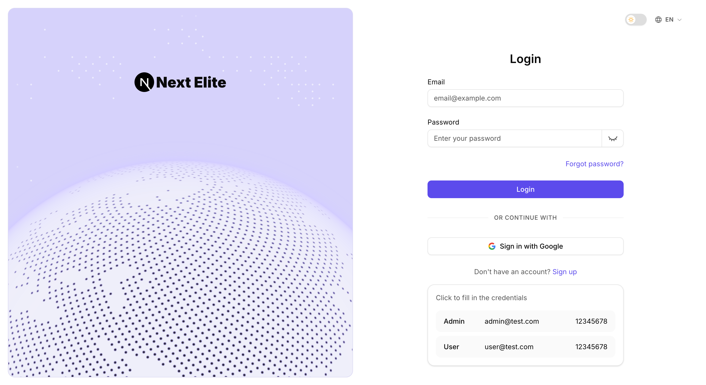
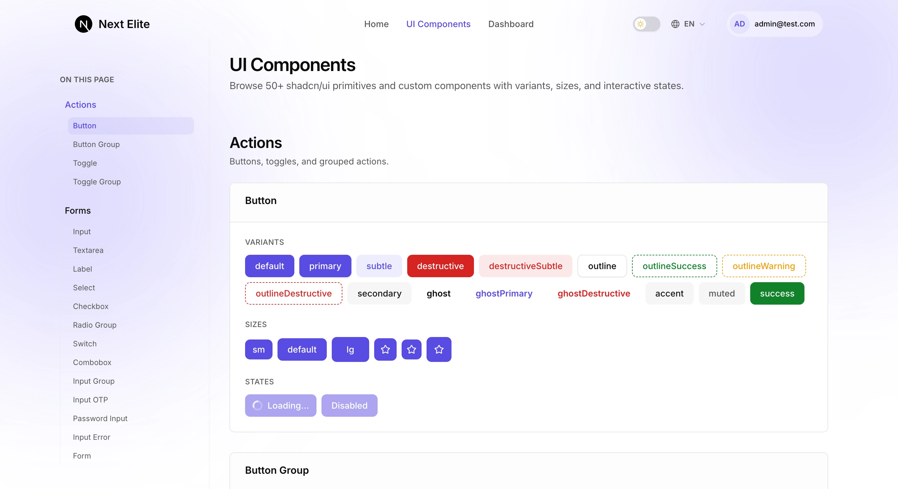
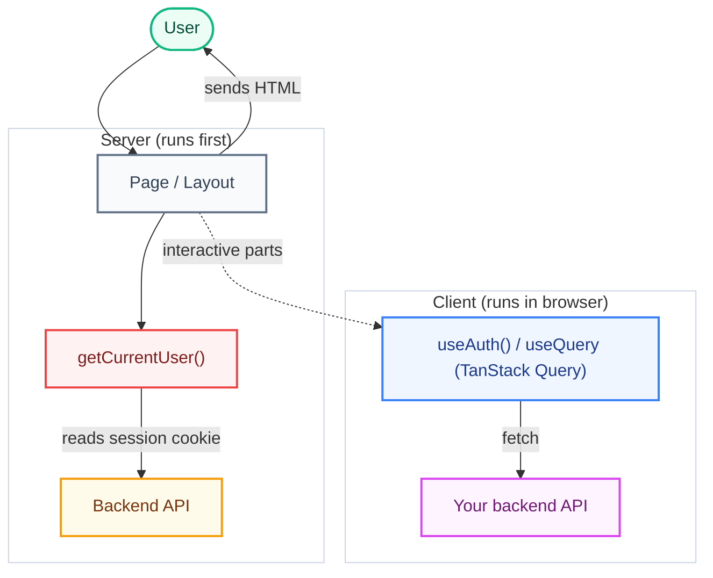

<h1 align="center">Next Elite</h1>

<p align="center">
  An open source Next.js boilerplate/starter kit with a frontend-focused, API-driven and great developer-experience setup. It's designed to consume external backends (REST, GraphQL, or BFF) while giving you a polished, production-ready <strong>authentication flow</strong> — split-pane auth layout, API-driven email/password sign-in, a protected dashboard and password reset — plus a reusable UI kit.
</p
<br/>
<p align="center">
  <a href="https://nextelite.salmanshahriar.com/"><strong>🚀 Live Demo</strong></a> ·
  <a href="https://github.com/salmanshahriar/Next-Elite/generate"><strong>📦 Use this Template</strong></a> ·
  <a href="https://github.com/salmanshahriar/Next-Elite/issues"><strong>🐛 Report Bug</strong></a> ·
  <a href="https://github.com/salmanshahriar/Next-Elite/issues"><strong>✨ Request Feature</strong></a>
</p>

<br/>

<div align="center">
  <table>
    <tr>
      <td width="50%" align="center">
        <h4>Auth Layout</h4>
        
      </td>
      <td width="50%" align="center">
        <h4>UI Components</h4>
        
      </td>
    </tr>
  </table>
</div>

<br/>

**Highlights & Features:**

- ⚡ **Next.js 16 + React 19** - Fast App Router, Turbopack, and Server Actions
- 🔥 **TypeScript** - End-to-end type safety across components and routes
- ✨ **Oxlint + Oxfmt** - Blazing-fast linting & formatting with Lefthook pre-commit hooks
- 🤖 **Next.js Best Practices** - Modular architecture, standalone Docker build, and performance optimizations
- 🔐 **Authentication** - API-driven email/password sign-in against your own backend, a protected dashboard, and password reset, with a permission-based RBAC model
- 🖼️ **Auth Layout** - Split-pane auth layout with a custom WebGL particle background, theme toggle, and language switcher
- 🎨 **Reusable UI Kit** - Accessible shadcn/ui primitives built with Tailwind CSS v4 & Radix UI
- 📚 **Type-Safe i18n** - Cookie-based localization (English + Hindi) powered by next-intl, with compile-time key checking
- 📝 **SEO & PWA Suite** - OpenGraph metadata, sitemap, robots.txt, and web manifest
- 🧪 **Comprehensive Testing** - Unit/component testing with Vitest and E2E testing with Playwright
- 🚀 **[Next Elite Server](https://github.com/salmanshahriar/Next-Elite-Server) (Coming Soon)** - Companion backend built with NestJS, BetterAuth, Drizzle ORM, PostgreSQL, and Multi-tenancy

<br/>

## 🚀 One-click Deploy to Vercel

[](https://vercel.com/new/clone?repository-url=https://github.com/salmanshahriar/Next-Elite)

Set environment variables from `.env.example` in Vercel project settings.

<br/>

## 💻 Tech Stack + Details

### Frameworks & Core

- **Next.js 16 (App Router)** - Fast, modern React framework with Turbopack, standalone output for Docker/self-hosting, and full support for React 19 features (Server/Client components, Server Actions).
- **TypeScript** - End-to-end type safety for rock-solid refactoring and developer experience.
- **Node.js 22** - Built on the latest LTS runtime.
- **Feature-Based Architecture** - Structured around self-contained vertical slices/feature folders under `src/features/` for maximum modularity and clean separation of concerns.

### Authentication & Access Control

- **API-driven Auth** - The login form posts to your backend (`POST /api/v1/auth/login`); the returned access token is stored in an httpOnly session cookie and read on the server. Configure the backend with `API_BASE_URL`.
- **Auth UI & Layout** - Split-pane authentication pages with a custom WebGL particle background animation, topbar with theme toggle and language switcher, a password-reset screen with back navigation, and a protected `/dashboard`.
- **Role-Based Access Control (RBAC)** - A flexible permission model (`user` and `admin` roles) with `hasPermission()` for the client and server-side guards for the dashboard. See `src/features/auth/rbac/`.

### Internationalization (i18n)

- **next-intl** - Type-safe, cookie-based localization (no URL prefix) with **English** and **Hindi**. Translation keys are type-checked (`t("key")` works; typos fail compile-time). More locales can be added in one place — see below.

### UI & Styling

- **Tailwind CSS 4** - Utility-first styling with `@tailwindcss/postcss` and `tw-animate-css`.
- **shadcn/ui** - Highly customizable UI components built with Tailwind CSS, Radix UI, and CVA.
- **Theme Support** - Easy light/dark mode transitions via theme toggle.

### API & Data Fetching

- **TanStack Query (React Query)** - Pre-configured `QueryClientProvider` in `src/app/providers.tsx` with sensible defaults (`staleTime`, `gcTime`, retry). Ready to wire `useQuery` / `useMutation` hooks to your REST, GraphQL, or BFF endpoints.
- **Next Elite Server (Coming Soon)** - Dedicated companion backend template powered by **NestJS**, **BetterAuth**, **Drizzle ORM**, and **PostgreSQL**.

### Observability & Infrastructure

- **Sentry Integration** - Complete error tracking and performance instrumentation for client and server.
- **Vercel Analytics** - Built-in page analytics via `@vercel/analytics`.
- **Health Probes** - Direct `GET /api/health` endpoint for load balancers.

### Quality Gates & Tooling

- **Hygiene & Linting** - [Oxlint](https://oxc.rs/docs/guide/usage/linter) and [Oxfmt](https://oxc.rs/docs/guide/usage/formatter) for fast linting and formatting, plus Knip for dead code/dependency hygiene.
- **Testing Suite** - Unit/component testing with Vitest and React Testing Library, and E2E testing with Playwright.
- **Git Hook Automation** - Lefthook pre-commit hooks (oxlint + oxfmt), Commitlint for conventional commits, and a pre-push hook that runs `npm run check`.

<br/>

## ⚡ Quick Start

### Prerequisites

- Node.js **22.12** or later
- **npm**

### Local Setup

1. Clone the repository and navigate into it:
   ```bash
   git clone https://github.com/salmanshahriar/Next-Elite.git
   cd Next-Elite
   ```
2. Install dependencies:
   ```bash
   npm install
   ```
3. Set up your environment variables:
   ```bash
   cp .env.example .env
   ```
4. Start the development server:
   ```bash
   npm run dev
   ```

Open [http://localhost:6767](http://localhost:6767) to view your local instance. The root `/` is the login screen; after a successful sign-in you land on the protected `/dashboard`.

### Docker & Production Containerization

The production setup uses a multi-stage **Google Distroless** base image (`gcr.io/distroless/nodejs22-debian12`) for maximum security, zero unnecessary OS packages, and minimal image size.

#### Quick Start with Docker

Run the application locally via Docker:

```bash
cp .env.example .env
docker build -t next-elite .
docker run --rm --env-file .env -p 6767:6767 next-elite
```

Or using Docker Compose:

```bash
docker compose up --build
```

#### Multi-Arch Deploy (ARM64 + AMD64)

```bash
docker buildx create --name multiarch --use   # one-time setup
docker buildx build --platform linux/amd64,linux/arm64 -t next-elite .
```

This is ideal for self-hosting on ARM servers (Oracle Cloud, Raspberry Pi, AWS Graviton, etc.).

#### Dokploy Deployment

This template is ready for [Dokploy](https://dokploy.com) - the open-source PaaS.

<br/>

## 🧩 Architecture Overview

The big picture: a page is rendered on the server, identity is resolved there, and any live data is fetched on the client.



**How a request flows:**

1. **User opens a page** - the Server Component renders first.
2. **Identity check** - `getCurrentUser()` reads the session cookie (set by the backend login) and returns the `AuthUser` (or `null`); the page branches or redirects accordingly.
3. **HTML is sent** to the browser; translations come from `messages/` via `next-intl`.
4. **Live data** (lists, forms, etc.) is fetched on the client with TanStack Query → your API (REST/GraphQL/BFF).

<details>
<summary><b>View Identity / RBAC Usage</b></summary>

```tsx
// Server Component example
import { getCurrentUser } from '@/features/auth/server/session';
import { getTranslations } from 'next-intl/server';
import { redirect } from 'next/navigation';

const MyPage = async () => {
  const user = await getCurrentUser();
  if (!user) redirect('/');
  const t = await getTranslations('myFeature');
  return <h1>{t('title')}</h1>;
};

export default MyPage;
```

</details>

<details>
<summary><b>View Forms Usage (React Hook Form + Zod)</b></summary>

```tsx
'use client';

import { zodResolver } from '@hookform/resolvers/zod';
import { useForm } from 'react-hook-form';
import { loginSchema, type LoginInput } from '@/features/auth/schemas/login';

const form = useForm<LoginInput>({
  resolver: zodResolver(loginSchema),
  defaultValues: { email: '', password: '' },
});
```

</details>

<br/>

## 🗂️ Project Structure

```
.
├── .github/
│   ├── workflows/            CI: check.yml + playwright.yml
│   └── renovate.json         Dependency updates
├── config/                   vitest.config.ts, vitest.setup.ts
├── e2e/                      Playwright specs + playwright.config.ts
├── messages/                 next-intl translations (en, hi)
├── public/                   Static assets
├── tests/                    Vitest specs (auth, i18n)
├── components.json
├── .oxlintrc.json            Oxlint rules (Next.js, TypeScript, React, Unicorn)
├── .oxfmtrc.json             Oxfmt formatter config (Tailwind class sorting)
├── knip.json
├── next.config.mjs
├── package.json              scripts + Commitlint config
├── package-lock.json
├── proxy.ts                  Next.js 16 network proxy
├── tsconfig.json
├── lefthook.yml              Git hooks (pre-commit, commit-msg, pre-push)
├── src/
│   ├── app/                  App Router
│   │   ├── (auth)/           Auth layout + pages (login `/`, password reset)
│   │   ├── dashboard/        Protected signed-in dashboard
│   │   ├── api/              Route handlers (auth login/logout, health)
│   │   ├── styles/           Design system tokens, base CSS
│   │   ├── fonts.ts          Typography configuration
│   │   ├── layout.tsx        Root layout, SEO, fonts, providers
│   │   ├── providers.tsx     Theme + Auth + TanStack Query
│   │   ├── manifest.ts
│   │   ├── robots.ts
│   │   └── sitemap.ts
│   ├── components/
│   │   ├── auth/             Auth forms, dashboard & WebGL background
│   │   ├── icons/            Phosphor icon helper, loader icon & barrel export
│   │   ├── layout/           App branding
│   │   ├── shared/           Shared UI (theme, language switcher, primitives)
│   │   └── ui/               shadcn/ui components
│   ├── features/             Feature modules
│   │   ├── auth/             API auth client, session helpers + RBAC modules
│   │   ├── i18n/             next-intl configuration
│   │   └── site/             siteConfig + locale utilities
│   ├── hooks/                Shared React hooks
│   ├── libs/                 Cross-cutting infra
│   ├── instrumentation.ts    Server Sentry init
│   ├── instrumentation-client.ts  Client Sentry init
│   └── global.d.ts           next-intl type augmentation
└── ...
```

<br/>

## ⚙️ Configuration

### Environment variables

Every variable is documented in [`.env.example`](.env.example) and validated by `src/libs/env.ts` (T3 Env).

| Variable              | Scope  | Notes                                                    |
| --------------------- | ------ | -------------------------------------------------------- |
| `NEXT_PUBLIC_APP_URL` | client | Public URL used for SEO / absolute links.                |
| `API_BASE_URL`        | server | Base URL of the backend API that handles authentication. |
| `SENTRY_DSN`          | server | Enables server-side Sentry.                              |

### Site & SEO configuration

[`src/features/site/site.config.json`](src/features/site/site.config.json) is the central place for SEO metadata, the sitemap, locales, and PWA manifest:

```json
{
  "appName": "Next Elite",
  "domain": "https://yourdomain.com",
  "tagline": "Frontend-first, API-driven, batteries included.",
  "title": "Next Elite - Production-Ready SaaS Boilerplate",
  "description": "Frontend-first Next.js 16 + React 19 boilerplate with i18n and API-driven auth."
}
```

<details>
<summary><b>Adding a Language</b></summary>

1. Add the locale code to `languages.supported` in `site.config.json` and add an entry under `languages.locales` (with `name`, `nativeName`, `locale`, `direction`).
2. Create `messages/<locale>.json` mirroring `messages/en.json`.
3. The `next-intl` runtime picks it up automatically; types update from `src/global.d.ts`.

</details>

<details>
<summary><b>Adding a Role</b></summary>

1. Append the role to the `UserRole` union in `src/features/auth/rbac/permissions.ts`.
2. Map permissions for the role in `src/features/auth/rbac/roles.ts`.
3. Use `hasPermission()` (client) and the guard pattern in `AGENTS.md` §10 for server enforcement.

</details>

<br/>

## 🧪 Development & Testing

<b>View Available Scripts</b>

| Command                           | Description                              |
| --------------------------------- | ---------------------------------------- |
| `npm run dev`                     | Start the dev server (port 6767)         |
| `npm run build`                   | Production build                         |
| `npm run start`                   | Start the production server (port 6767)  |
| `npm run start:standalone`        | Run standalone server (Playwright CI)    |
| `npm run analyze`                 | Build with `@next/bundle-analyzer`       |
| `npm run typecheck`               | `tsc --noEmit`                           |
| `npm run lint`                    | Oxlint + Oxfmt check                     |
| `npm run lint:fix`                | Auto-fix with Oxlint + Oxfmt             |
| `npm run format`                  | Format with Oxfmt                        |
| `npm run format:check`            | Check formatting with Oxfmt              |
| `npm run knip`                    | Detect unused files / exports / deps     |
| `npm run check`                   | CI gate: typecheck + lint + knip + tests |
| `npm run test`                    | Vitest run                               |
| `npm run test:watch`              | Vitest watch mode                        |
| `npm run playwright:install`      | Download Playwright browsers             |
| `npm run playwright:install:deps` | Install OS libs for browsers (Linux)     |
| `npm run e2e`                     | Playwright E2E                           |
| `npm run e2e:ui`                  | Playwright UI mode                       |
| `npm run e2e:webkit`              | Playwright WebKit only                   |

</details>

<details>
<summary><b>Editor Setup</b></summary>

Install the [Oxc VS Code extension](https://marketplace.visualstudio.com/items?itemName=oxc.oxc-vscode) (`oxc.oxc-vscode`) for format-on-save and Oxlint fix-on-save. Project settings in `.vscode/settings.json` are preconfigured.

</details>

<details>
<summary><b>Testing Details</b></summary>

- **Unit / component:** Vitest + React Testing Library (`config/vitest.config.ts`). Use `renderWithProviders` from `@tests/utils/render` for components that need app context (i18n, theme, auth, React Query). Plain `render` is fine for isolated UI primitives.
- **End-to-end:** Playwright in `e2e/` on port **6767** (`127.0.0.1`). Local runs use `next dev` (all browsers); CI uses production `next start` (Chromium only). Run `playwright:install` before the first E2E run; on Linux, WebKit needs `playwright:install:deps` (sudo). Stop `npm run dev` before `npm run e2e` - E2E starts its own server.

</details>

<details>
<summary><b>CI/CD Pipeline</b></summary>

- `.github/workflows/check.yml` - typecheck → lint → knip → unit tests → build, on every push and PR.
- `.github/workflows/playwright.yml` - build → Playwright E2E (Chromium, production server).
- `.github/renovate.json` - groups non-major dependency updates and automerges patches.

</details>

<br/>

## 🎯 When to Use

Next Elite is best for:

- Products that need a polished, type-safe authentication flow out of the box.
- Multi-lingual/Internationalized products (English + Hindi today; the RTL plumbing is retained).
- Frontends consuming an existing backend or BFF.
- Projects requiring a clean, feature-based modular structure.

It is probably overkill for:

- Single-page landing sites.
- Apps that need a tightly-coupled DB layer (API-only design).

<br/>

## 🤝 Contributing

Contributions to **Next-Elite** are welcome.

1. Fork the repository and create a branch from `main`.
2. Use clear branch names such as `feat/...`, `fix/...`, or `docs/...`.
3. Run `npm run check` before submitting your changes.
4. Follow **Conventional Commits**.
5. Open a Pull Request with a clear description of your changes.

<br/>

## 📜 License

MIT [LICENSE](LICENSE)

<br/>

## ⭐ Support Next-Elite

If you find **Next-Elite** useful, consider giving it a ⭐ **[Star on GitHub](https://github.com/salmanshahriar/Next-Elite)**.

Thanks for reading!
